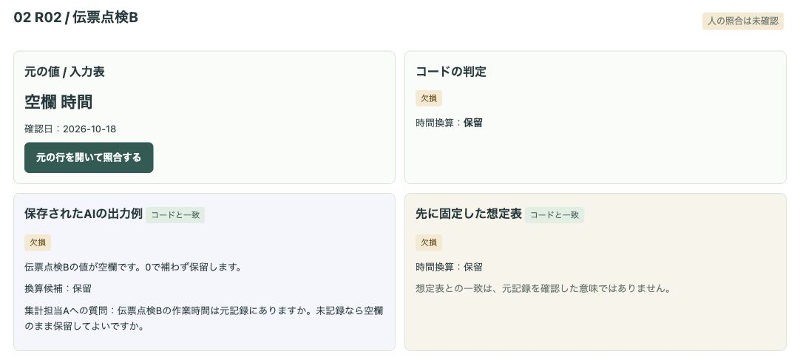
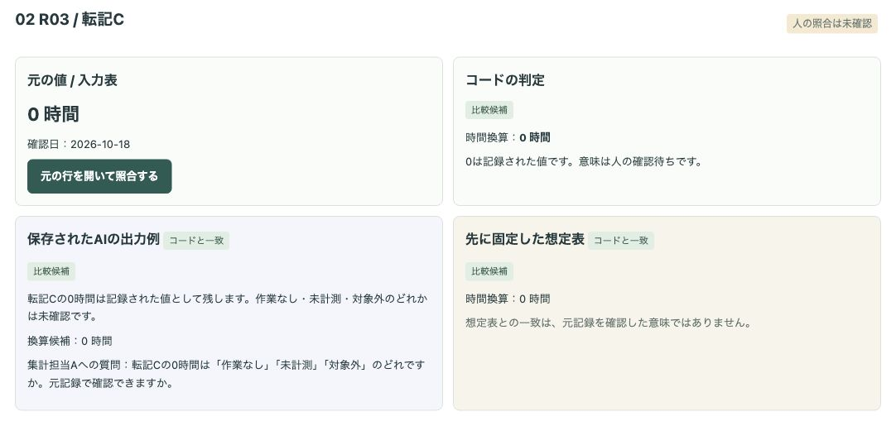
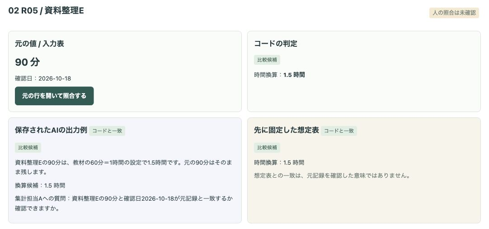
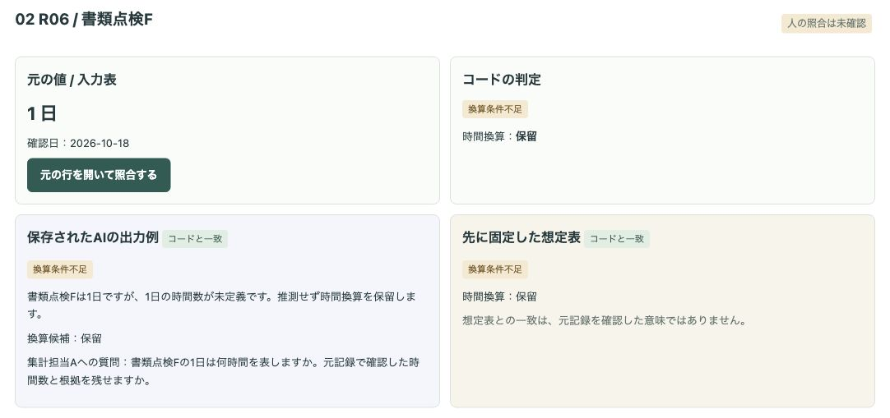
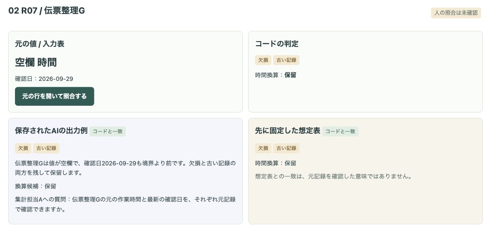
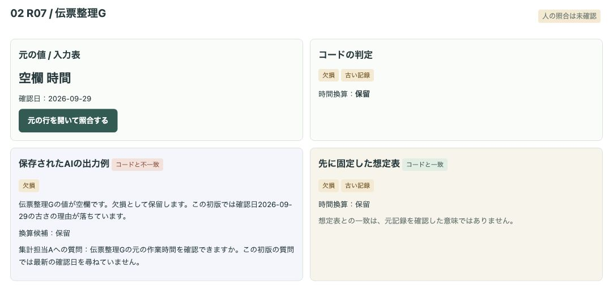
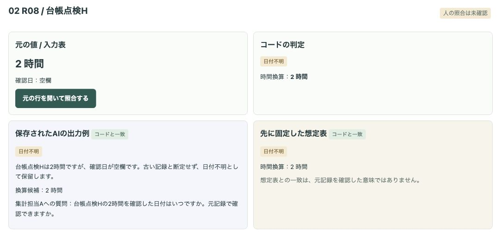
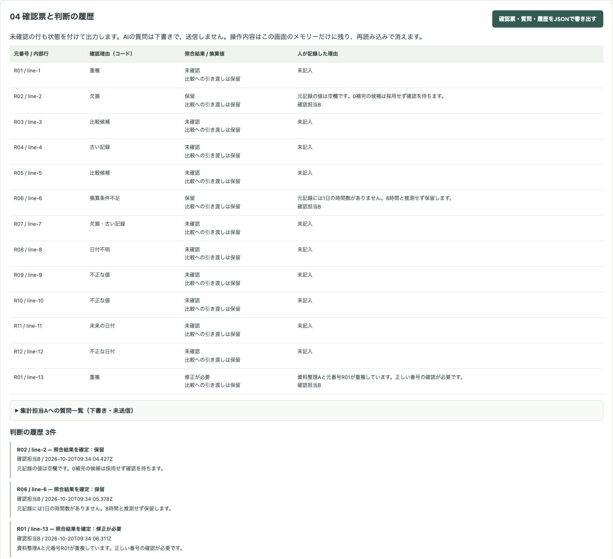
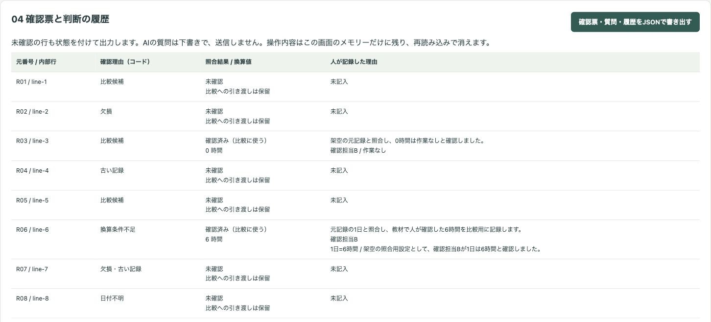

# 架空の業務表で、欠損・古い記録・単位違いの確認理由を残して人が照合するデモ

集計の前に、作業時間表の行ごとの確認理由をコードで判定し、AIの整理と質問の下書きを照合する公開デモです。人が元記録を開き、照合結果と理由を残して確認票を書き出します。

会社「サンプル事務室」、作業名、役割名、数値、日付、照合理由はすべて架空です。実際の業務の実績ではありません。時間の削減・精度・費用など、測っていない効果は示していません。

## 画面の画像

欠損と0を区別します。空欄は補完せず、0の意味は人が確認します。




90分は1.5時間になります。「日」は定義がないので保留します。




R07は欠損と古い記録の両方を保持します。初版ではAIの「古い記録」が落ち、コードと不一致になります。R08は日付不明であり、古いと断定しません。





以下は照合用に意図的に入れた誤りです。AIの自然な失敗を観察した結果ではありません。人が補完・推測を保留し、重複を修正が必要と判断しています。



0の意味と日の時間数を人が確認した場合は、入力者と根拠を残して比較に渡せます。



## 試せること

1. 初期の8行を選び、元の値・コード判定・AIの理由と質問・固定した想定表を見比べる。初版、修正版、誤りの教材を切り替える。
2. 表を編集・追加し、CSVを貼り付けて置き換える。編集した行は再整理待ちになり、保存済みAI出力を使わなくなる。
3. 仮ルールの基準日・古さの境界・分の換算表を編集し、確認理由の延べ件数と比較保留の行数を分けて確認する。
4. 「元の行を開いて照合する」を押し、人が役割名・照合結果・理由を入力する。0は「作業なし」「未計測」「対象外」のいずれかを選ぶ。「日」は確認した1日の時間数と根拠を入力する。
5. 確認票、集計担当Aへの質問の下書き、誰が・いつ・どの行を・どう判断したかと理由の履歴を、1つのJSONに書き出す。書き出したJSONは画面でも確認・コピーできる。

「比較候補」は仮ルール上の問題がないという意味です。元記録を確認済み・集計してよいという意味ではありません。確認済みとするには、元の行を開き、理由を入力し、AIの内容を照合する必要があります。欠損・不正な値や日付・重複・日付不明・未来日は比較に使えません。古い記録は元記録と照合した理由を残して判断します。0が未計測・対象外の場合も比較には使えません。

### 教材の設定

基準日は2026-10-20、古さの境界は2026-10-01です。境界より前だけを「古い記録」とし、確認日が空欄なら「日付不明」とします。時間はそのまま、分は60で割ります。「日」の時間数は推測しません。これらは教材の仮ルールで、業種共通の基準や勤務時間の定義ではありません。

| 元番号 | 作業名 | 値 | 単位 | 確認日 | 固定した想定理由 |
| --- | --- | --- | --- | --- | --- |
| R01 | 資料整理A | 2 | 時間 | 2026-10-18 | 比較候補 |
| R02 | 伝票点検B | 空欄 | 時間 | 2026-10-18 | 欠損 |
| R03 | 転記C | 0 | 時間 | 2026-10-18 | 比較候補（意味は人が確認） |
| R04 | 台帳整理D | 3 | 時間 | 2026-09-30 | 古い記録 |
| R05 | 資料整理E | 90 | 分 | 2026-10-18 | 比較候補（1.5時間） |
| R06 | 書類点検F | 1 | 日 | 2026-10-18 | 換算条件不足 |
| R07 | 伝票整理G | 空欄 | 時間 | 2026-09-29 | 欠損・古い記録 |
| R08 | 台帳点検H | 2 | 時間 | 空欄 | 日付不明 |

`data/input.json` に表・仮ルール・独立した想定表、`data/ai-output.json` に初版・修正版・誤りの教材の出力を保存しています。想定表は初期の8行と仮ルールに固定し、編集後の値に追従させません。誤りの教材ではR01の重複が加わるため、初期のR01も想定表と不一致になります。

誤りの教材では5行を追加しています。R09は「二」という文字列、R10は負の値、R11は未来日、R12は存在しない日付、最後の行は元番号R01の重複です。さらにR02のAI候補に空欄の0補完、R06のAI候補に「1日＝8時間」の推測換算を入れています。この版は照合用に意図的に入れた行を含みます。モデルの性能評価ではありません。

### 編集と手動のAI出力取り込み

事前に用意したAIの出力例を再生しています。その場でAIを呼んでいません。入力を変えた行は再整理待ちになり、AIは再処理しません。仮ルール変更時は全行、表の編集時はその行と重複判定が変わった行、行の追加時は重複判定が変わった既存行のAI出力・照合結果を解除します。確定済みの結果を解除したことも履歴に残します。版の切り替えでは表と照合結果を初期化し、履歴は残します。再読み込みではすべて消えます。

「現在の表の指示とJSONひな形をコピー」で、自由記述を指示として扱わない指示、項目の説明、現在の入力とコード判定をコピーできます。任意の生成AIで下書きを作る場合にも、架空データだけを使ってください。このデモは生成AIに接続しません。出力は人が編集しても構いません。

出力の `rules`、各行の `key` と `source` をそのまま返し、`reasons`（理由の配列）、`summary`（理由の整理）、`question`（質問）、`hours`（換算値、保留はnull）を入れます。現在の入力と一致するJSONを「AI出力のJSON」に貼り付けて取り込み、元の行を開き直して照合・確定できます。部分的な取り込みも可能です。初版・誤りの教材では、JSONを取り込んだ行を除き「確認済み（比較に使う）」を選べません。保留・修正が必要は記録できます。書き出しには教材の版と、取り込んだ出力の印を残します。コードとの理由・換算値の不一致は画面に残り、比較に使う確定を止めます。質問や理由の文章の妥当性は人が確認します。

CSVは `id,task,value,unit,date` の見出しと5列です。日付は `YYYY-MM-DD`、値の空欄は空欄のまま読み込みます。引用符と欄内の改行に対応します。上限は100行、100,000文字、各欄300文字です。表を置き換えるため、事前に必要な確認票を書き出してください。AI出力JSONは300,000文字までです。

## 実際の業務で使うイメージ

以下は想定であり、導入実績ではありません。集計担当が元表の控えを用意し、業務に合う仮ルールを決め、確認担当が行ごとの理由を元記録に照らして確認票に残す流れを想定しています。元表の修正や担当者への質問の送信はデモの外で行います。

## AI・コード・人の分担

- AI：自由記述の確認理由を整理し、担当者への質問を下書きする。値の補完、1日の時間数の決定、集計可否の判断はしない。
- コード：空欄・0・確認日・単位・重複・不正な値の判定、換算、想定表との比較、未確認の確定防止、再整理待ち、書き出し、画面表示を担当する。
- 人：仮ルールを決め、元記録と照合し、0や日の意味、照合結果と理由を記録する。日の換算では入力者と根拠も残す。

## 起動手順

Node.js 22以降とnpmを使用します。追加パッケージのインストールは不要です。

```sh
git clone https://github.com/gishi-dev/business-table-quality-review.git
cd business-table-quality-review
npm start
```

端末に起動の表示が出たら、ブラウザのアドレス欄に `http://127.0.0.1:4191` を入力します。端末で `Ctrl+C` を押すと停止します。構文確認は `npm run check` で行えます。

## デモの範囲と実業務で必要なこと

ローカルの画面内だけで動作します。外部API、認証情報、APIキーは使いません。環境ファイルも読み込みません。外部へのリンクや接続、元表の上書き、業務ソフトへの登録、質問の送信はありません。AIに自由な操作やコード実行はさせません。特定の表計算ソフト・業務ソフトへの対応や、個別の労務・会計判断は含みません。

ここで開く元記録は表の読込時の控えです。入力編集後も控えは独立して残します。0や日の定義を示す別の資料はないため、人が照合したという教材上の根拠を入力します。実際の元記録の証明や本人確認にはなりません。履歴の時刻は利用端末の時計、役割名は自己申告です。改ざん防止や監査証跡の保証はありません。表示上の換算値は小数6桁まで、JSONには計算値を残します。

実業務では、元記録の保管とアクセス権、単位・鮮度・0の定義、承認責任、データの持ち出し条件、履歴の永続化と監査要件を別途決める必要があります。実在の会社・人物・お客様の情報や認証情報を入力しないでください。

## 使っているOSSとライセンス

このデモのコード・教材・画像はMITライセンスです（`LICENSE`）。実行環境はNode.js（MITライセンスと同梱コンポーネントのライセンス）、起動コマンドはnpm（Artistic-2.0）を使用します。アプリの追加OSS依存、外部フォント、外部画像はありません。
